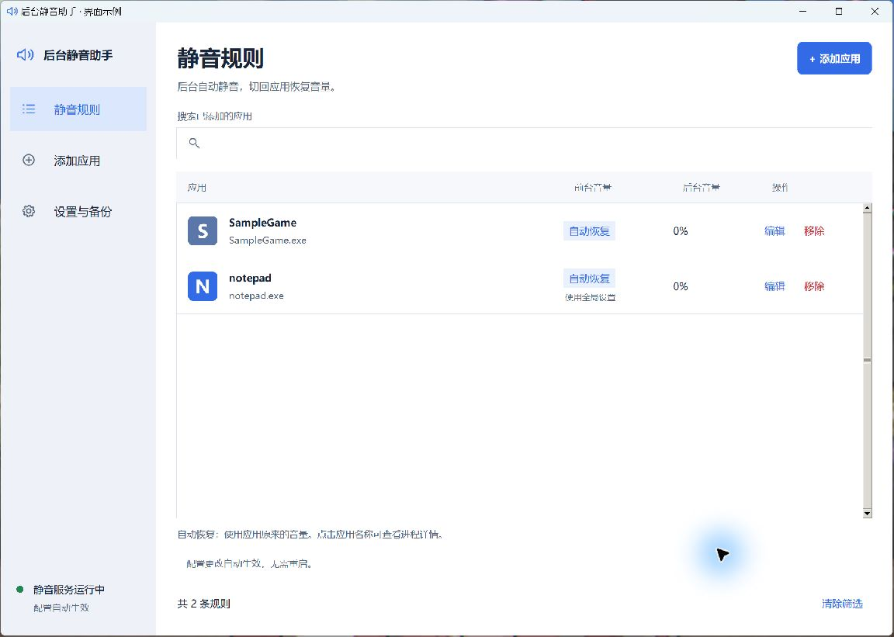

# 后台静音助手 · MuteFlow

让选定的应用在后台自动静音，切回前台恢复音量。支持 Windows 10 / 11。

基于 [lingkai5wu/AutoMuteBG](https://github.com/lingkai5wu/AutoMuteBG) v0.2.2 改进，保留原项目的 MIT 许可证和版权声明。本仓库是独立维护的修改版，不是原作者发布的官方版本。

## 下载和使用

1. 到 [Releases](https://github.com/Heisenberg-cmd0079/MuteFlow/releases/latest) 下载 `MuteFlow-*-windows-x64.zip`。
2. 把 ZIP 完整解压到固定目录，例如 `D:\Apps\MuteFlow`。
3. 双击 **后台静音助手.exe**，在“添加应用”中选择要在后台静音的应用。
4. 想让它随 Windows 启动，在“设置与备份”中开启“开机自动启动静音服务”。

`manager_runtime` 和 `muter_runtime` 是配套运行库，请和两个 exe 一起保留。关闭管理器后，静音服务仍在后台运行；从系统托盘选择“退出”，才会退出服务。

## 主要功能

- 应用图形化管理：搜索、勾选批量添加、逐行编辑与移除。
- 前台自动恢复原音量，后台静音，也可分别设置音量。
- 配置热加载：运行中新增、修改、删除规则会自动生效。
- 移除规则或安全退出时恢复音量，避免应用卡在静音状态。
- 主进程开窗口、子进程放音频的应用按同一可执行文件判定前后台。
- 同名进程合并显示；可查看进程、窗口和路径详情。
- 配置自动备份、备份恢复和开机启动设置。
- 单实例互斥、扫描线程监控和工作进程异常退出后的有限次数重启。

托盘菜单只保留 **进程管理、进程列表、退出**。

## 界面示例

下图使用示例规则，不包含维护者的个人配置。



## 音量与配置

- `fg_volume: auto`：恢复接管应用时记录的音量。
- `bg_volume: 0`：后台完全静音；`0.2` 表示 20% 音量。
- 规则值为 `null`：沿用全局默认设置，不表示禁用。
- `config.example.yaml` 是示例；实际规则保存在程序目录的 `config.yaml`。

修改配置前会保存备份。运行中的无效 YAML 不会替换服务的上一份有效配置。日志位于 `logs`，音量恢复记录位于 `volume_recovery.json`。

## 从源码运行

需要 Windows、64 位 Python（本版本使用 Python 3.14 构建）以及 Python 自带的 Tk。

```powershell
python -m venv .venv
.\.venv\Scripts\python.exe -m pip install -r requirements-dev.txt
Copy-Item config.example.yaml config.yaml
.\.venv\Scripts\python.exe main.py
```

另开一个终端运行管理器：

```powershell
.\.venv\Scripts\python.exe muter_gui.py
```

源码模式下先启动 `main.py`；管理器的自动启动功能寻找的是打包后的服务 exe。

## 构建和测试

```powershell
.\.venv\Scripts\python.exe -m unittest discover -s tests -v
.\.venv\Scripts\python.exe tools/build_release.py
```

构建脚本使用相对路径，生成两个免临时解包的目录程序，再组装成一个 ZIP。产物位于 `dist`。

测试包含模拟音频会话、配置读写、界面操作、窗口归并和隔离的进程互斥。真实 DRAPLINE 用例在应用未运行时会跳过。

## 当前限制

- 仅支持 Windows 的应用音频会话，不控制应用内部的音量滑块。
- 规则按 exe 名称配置；同名应用会共用规则。
- 管理器关闭不会停止后台静音服务。
- 整个进程树被结束或系统关闭时，监控进程无法保证自动恢复；下次启动会尝试恢复已记录的会话。

## 反馈

遇到问题可在 [Issues](https://github.com/Heisenberg-cmd0079/MuteFlow/issues) 提交应用名称、操作步骤和错误信息。贴日志前请去掉其中不想公开的路径或窗口标题。

## 许可和致谢

原项目：[AutoMuteBG](https://github.com/lingkai5wu/AutoMuteBG)，Copyright (c) 2023 Wuu。

修改版由 [Heisenberg-cmd0079](https://github.com/Heisenberg-cmd0079) 维护，继续使用 [MIT License](LICENSE)。第三方依赖保留各自许可证，构建产物会附带许可文件。
